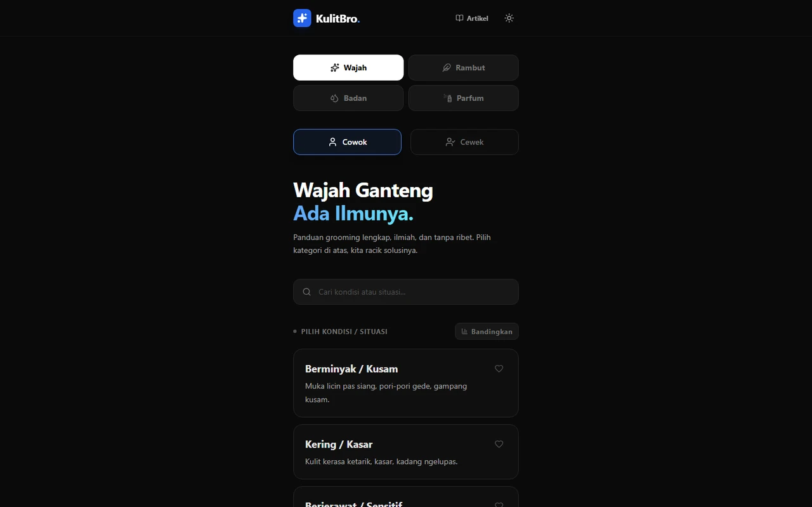
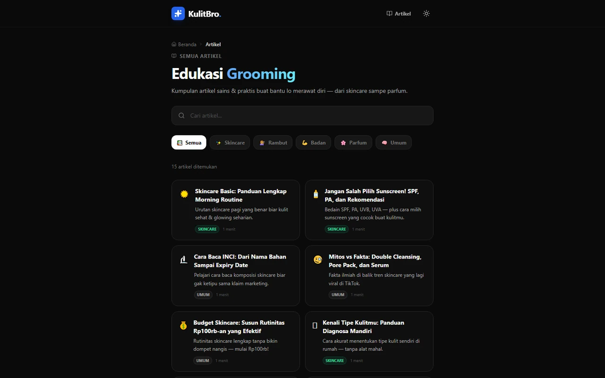
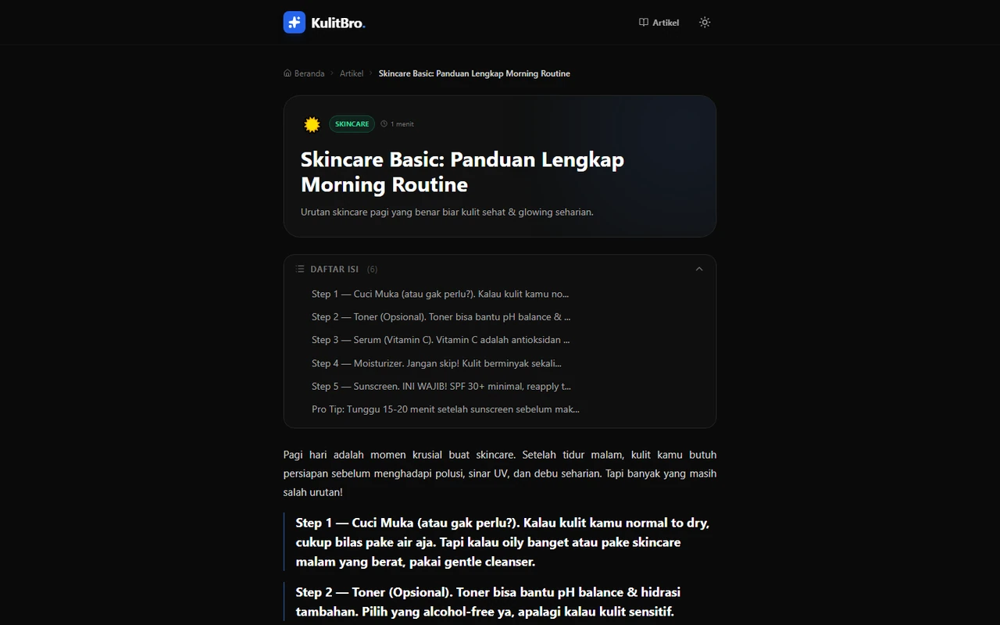
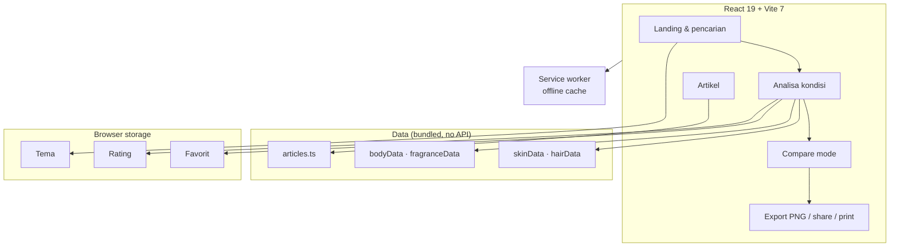

# KulitBro — Smart Grooming Assistant

**Panduan grooming berbasis sains untuk cowok & cewek Indonesia — bukan thread mitos di media sosial.**

---

## Masalahnya

Informasi perawatan kulit dan rambut di Indonesia beredar sebagai thread, tangkapan layar, dan
rekomendasi afiliasi. Isinya campur: sebagian benar, sebagian mitos, hampir semuanya tanpa
sumber, dan hampir selalu mengarah ke satu produk tertentu tanpa menjelaskan **kenapa**.

Orang akhirnya membeli mahal, salah sasaran, atau berhenti di tengah rutinitas karena tidak tahu
mana yang sebenarnya berpengaruh.

## KulitBro

PWA yang membalik urutannya: mulai dari **kondisi**, bukan dari produk. Pilih kondisi kulit,
rambut, badan, atau kebutuhan parfum — lalu dapatkan rutinitas yang masuk akal, estimasi budget,
dan penjelasan ilmiah di baliknya, termasuk bantahan mitos yang paling sering beredar.

**59 entry kondisi** untuk cowok dan cewek, **15 artikel edukasi**, semuanya berjalan di browser.

### Fitur

- **Analisa kondisi** — 59 entry lintas kulit, rambut, badan, dan parfum
- **Compare mode** — dua kondisi bersebelahan: mitos, fakta, budget, rutinitas
- **Artikel edukasi** — 15 artikel dengan JSON-LD structured data untuk SEO
- **Favorit & rating** — tersimpan di `localStorage`, tanpa akun
- **Export hasil** — simpan analisa sebagai PNG (html2canvas) atau bagikan ke WhatsApp
- **Print mode** — tata letak khusus cetak
- **Light/dark mode** — persistensi lokal
- **PWA** — installable, offline-ready, auto-update
- **Pencarian & filter** — kondisi dan artikel
- **Aksesibilitas** — ARIA label, navigasi keyboard, focus-visible ring, dukungan reduced-motion

---

## Tampilan

| Beranda — pilih kondisi | Daftar artikel |
| :---: | :---: |
|  |  |

**Detail artikel** — daftar isi otomatis, konten siap baca di ponsel.

---

## Arsitektur

Keputusan desain:

- **Nol backend.** Semua konten di-bundle sebagai modul TypeScript, jadi tidak ada API key, tidak
  ada biaya server, dan aplikasi tetap berfungsi saat offline.
- **Data sebagai kode.** Konten kondisi punya tipe, sehingga entry yang salah bentuk gagal saat
  build, bukan saat dibuka pengguna.
- **Privasi sebagai default.** Favorit, rating, dan tema hanya ada di perangkat pengguna.

---

## Stack

| Kategori | Teknologi |
| :--- | :--- |
| Framework | React 19 + TypeScript 5.9 |
| Build | Vite 7 |
| Styling | Tailwind CSS 3.4 |
| Distribusi | PWA (service worker, offline) |
| Export | html2canvas |
| SEO | JSON-LD structured data |

---

## Status

Aplikasi ini **live sebagai produk**, dan source code-nya disimpan privat.

Repository ini adalah **showcase**: dokumentasi produk, arsitektur, dan keputusan desain.
Isi `src/` tidak dipublikasikan.

Untuk pertanyaan, demo, atau diskusi teknis: buka issue di repository ini.

---

## English

**KulitBro** is a grooming guide for Indonesian readers that starts from a condition, not from a product. Pick a skin, hair, body, or fragrance concern and get a routine, a budget estimate, the reasoning behind it, and the myths that keep circulating — 59 condition entries and 15 educational articles, for men and women.

It is a client-side PWA: content is bundled, favourites and ratings stay in the browser, and the app keeps working offline.

The source code is not published; this repository documents the product.

---

**Dibuat oleh [Kandar Lubis](https://github.com/kandarlubis31)**

---

## Lisensi

**All Rights Reserved.** Copyright © 2026 Kandar Lubis.

Kode sumber tidak dipublikasikan dan tidak dilisensikan untuk digunakan ulang. Dokumentasi ini
disajikan untuk peninjauan dan evaluasi.
